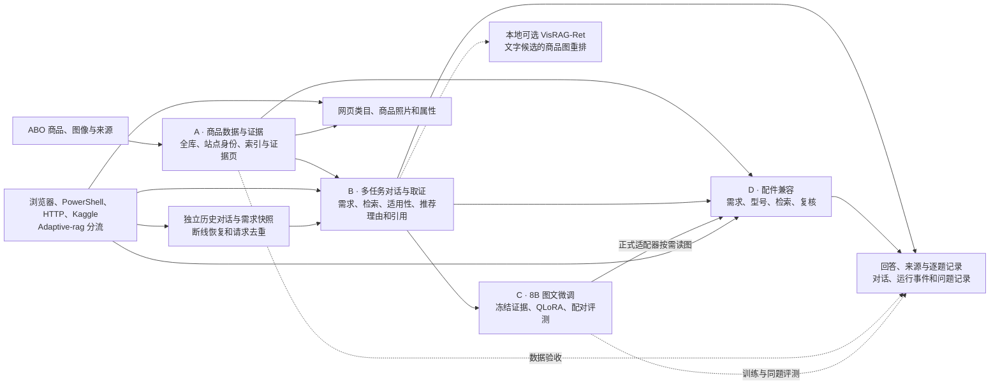

# ABO Adaptive RAG 商品助手

这套项目直接从 [Adaptive-rag](https://github.com/JEen-wang/Adaptive-rag/tree/2a12a62382a8c3ec033fa9a5b19b9b23b8780ab8) 的源码开发，使用 FastAPI 和 LangGraph 运行 ABO 商品助手。全量库有 147,702 条商品记录、576 个原始类目和 32 个站点。商品以 ASIN@站点定位。

- 查商品、规格和原始资料时给出来源。会话可以继续看当前商品，也可以显式切换到目录。
- 回答默认使用 ABO 原始商品名称和自然句子。商品编号保存在引用和逐题记录中，可按需显示。
- 可按类目和站点统计历史记录，也可按明确的颜色、材质、尺码和款式筛选并继续调整条件。尺码引用原始标注，同站点变体另行核对。
- 比较重量、尺寸和类别属性时分别核对来源。缺价格、库存或执行能力时说明边界。
- 本地 GPU 与 Kaggle 的 Qwen3-VL-8B-Instruct 每轮规划多个必要任务，组合商品检索、需求适用性、推荐理由、属性、计数、兼容、政策和图片。源字段重新核查，未知年龄适用性不能当成已验证推荐。C 阶段 120/50 图文 LoRA 与 D 阶段四角色兼容检查保留。

[统一问答架构](docs/ABO架构与验证.md) · [A–D 阶段详细流程](docs/A-D阶段流程.md) · [日志与排查](docs/日志与排查.md) · [上游原始说明](README.upstream.md)

## 打开网页问答台

从 GitHub 下载 ZIP 并解压，或克隆本仓库。项目根目录里的 **`start-web.cmd` 是网页的统一启动文件**。首次启动需要网络和至少 2 GB 空闲磁盘。 [下载项目 ZIP](https://github.com/AaronYue77/ABO-Adaptive-RAG/archive/refs/heads/main.zip)

**Windows** 双击 `start-web.cmd` 就能启动。在已打开的项目 PowerShell 窗口里，运行同一个文件也可以：

```powershell
.\start-web.cmd
```

**macOS 和 Linux** 在项目根目录用系统终端运行同一个文件：

```sh
sh ./start-web.cmd
```

启动器会选用可用的 Python 3.11 或其他受支持的更新版本，缺少时自动下载并校验一份便携 Python，放在项目目录内。它随后建立独立环境、下载公开的 ABO 数据、构建全量索引并打开浏览器。再次启动会复用已准备的环境与索引。支持笔记本和台式机上的 64 位 Windows、macOS，以及使用 glibc 的 64 位 Linux。Windows 11 ARM 使用系统的 x64 应用兼容模式。Linux 的便携下载需要 `curl` 或 `wget`。 [便携 Python 来源](https://github.com/astral-sh/python-build-standalone/releases/tag/20261110)

使用时保持启动窗口运行。浏览器未自动打开时，点击 [本机问答台](http://127.0.0.1:8769/)。按 `Ctrl+C` 停止服务。端口被占用时，给同一个启动命令加上 `--port 8770`。

新对话先显示 576 个类目。点类目分页浏览全量商品，再点商品卡核对原始属性、站点和来源行。发送问题即切换到对话，搜索、兼容候选和有取证的外观相关回复可附商品图片。计数、一般规格追问、售后和未接实时业务查询用文字回答。目录使用 ABO 原图及其缩略图。全库目前有 575 个类目能找到官方封面，发箍与发带在原始记录中没有附图，其商品仍可查看。 [图片署名与数据来源](docs/网页商品图片.md)

默认使用本机 CPU 查询历史商品资料，启动只依赖公开资产，无需 NVIDIA 显卡、模型下载、Node.js 或 Kaggle 账号。需要 Qwen3-VL-8B 时，可以用自己的 Kaggle 账号复制公开 Notebook，再从网页右上角连接。 [公开 8B Notebook](https://www.kaggle.com/code/aaronyue77/abo-adaptive-rag-public-8b) · [Kaggle 连接说明](docs/Kaggle调用与LoRA导出.md)

历史对话可以继续提问。点击“新对话”建立独立上下文，回到历史时恢复该段需求和商品选择。刷新网页或重启本机服务后仍可恢复；Kaggle 会话结束后，需要连接新的有效地址再续聊。临时通道故障会有限重连，并用请求编号避免重复执行。日志和历史保存在本机项目目录，不会上传到 GitHub。 [多任务对话与恢复机制](docs/多任务对话与恢复.md)

## A-D 总流程



[A 阶段](docs/A-D阶段流程.md#a-阶段) · [B 阶段](docs/A-D阶段流程.md#b-阶段) · [C 阶段](docs/A-D阶段流程.md#c-阶段) · [D 阶段](docs/A-D阶段流程.md#d-阶段)

## Kaggle

1. 登录 Kaggle，打开 [ABO Adaptive RAG Public 8B](https://www.kaggle.com/code/aaronyue77/abo-adaptive-rag-public-8b)，用 **Copy & Edit** 建立副本。
2. 启用 **Internet** 和 NVIDIA GPU，保留官方 Qwen3-VL-8B-Instruct 模型输入。运行第一个代码单元格，等到「ABO 商品助手已就绪」。Notebook 会从公开渠道取得项目代码、ABO 全量数据和正式 LoRA，并核对数据和权重摘要。
3. 保持会话运行，打开 **Run → Kaggle Jupyter Server**，复制自己的 **VSCode Compatible URL**。在本机网页点 **连接 Kaggle**，把地址粘贴进去。也可以在自己的 Notebook 里用 `ask("茶杯")` 提问。

在 PowerShell 中也可以用同一个会话地址，将 URL 粘贴到命令的本机提示处。

```powershell
.\scripts\run_abo.ps1 -Command cloud-chat
```

[Kaggle 调用、QLoRA 训练与导出](docs/Kaggle调用与LoRA导出.md) · [公开 Notebook 源文件](scripts/kaggle_abo_public.ipynb) · [下载正式 LoRA 适配器](https://github.com/AaronYue77/ABO-Adaptive-RAG/releases/tag/qwen3-vl-8b-abo-lora-v1)

## 本地开发

已配置的本地工作区可直接打开 PowerShell 运行。

```powershell
.\scripts\run_abo.ps1 -Command check
.\scripts\run_abo.ps1 -Command chat
.\scripts\run_abo.ps1 -Command chat -Gpu
.\scripts\run_abo.ps1 -Command chat -Visual
```

`chat` 用本机索引查目录、源字段和文本兼容证据。`-Gpu` 从 `abo_runtime/models/Qwen3-VL-8B-Instruct` 读取官方底座，在本机 GPU 用 NF4 运行。`-Visual` 使用 `abo_runtime/models/VisRAG-Ret` 给至多六个文字候选的商品图重排。公共原图若未缓存，则按需下载。模型安装、资产恢复和显存说明见 [本地模型与启动](docs/本地模型与启动.md)。

网页启动后，接口说明在 `http://127.0.0.1:8769/docs`。请求 `POST /api/v1/chat` 时传入 `question`，再用返回的 `session_id` 续聊。

运行 `-Command logs` 可查看操作、问题与逐题汇总的位置。每次会话保存可见对话、逐题证据和运行事件。远程 PowerShell 会话也保存已收到的结果和连接异常。[日志内容与排查方法](docs/日志与排查.md)

## 验收范围

本地新增了 49 个真实商品对话回归用例，以及覆盖 576 类的一商品选择和资料追问检查。旧冻结的 A、B、C、D 数据协议适用原实验口径。已运行结果保存在工作区下的 `abo_runtime/reports/ecommerce_rag`，包括原始 JSONL 与逐题 TXT。

项目主体保留 Adaptive-rag 的 MIT 许可。复用的 VisRAG 派生代码保留 [Apache-2.0 许可](abo_runtime/upstream/VisRAG/LICENSE)。模型与 ABO 数据分别遵循各自的发布许可。训练二进制、私有数据夹具与本地运行日志保存在授权的工作区与 Kaggle 输入中。
