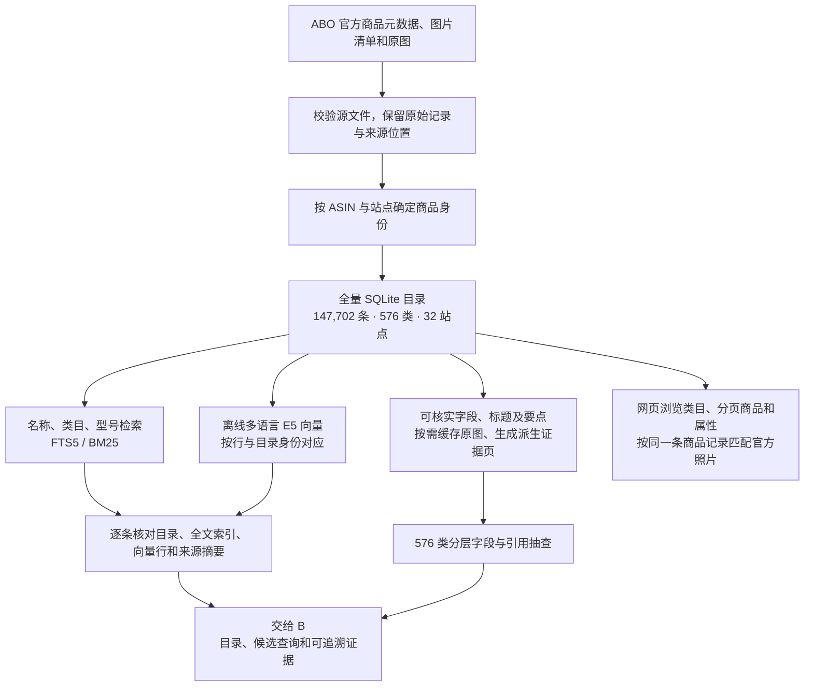
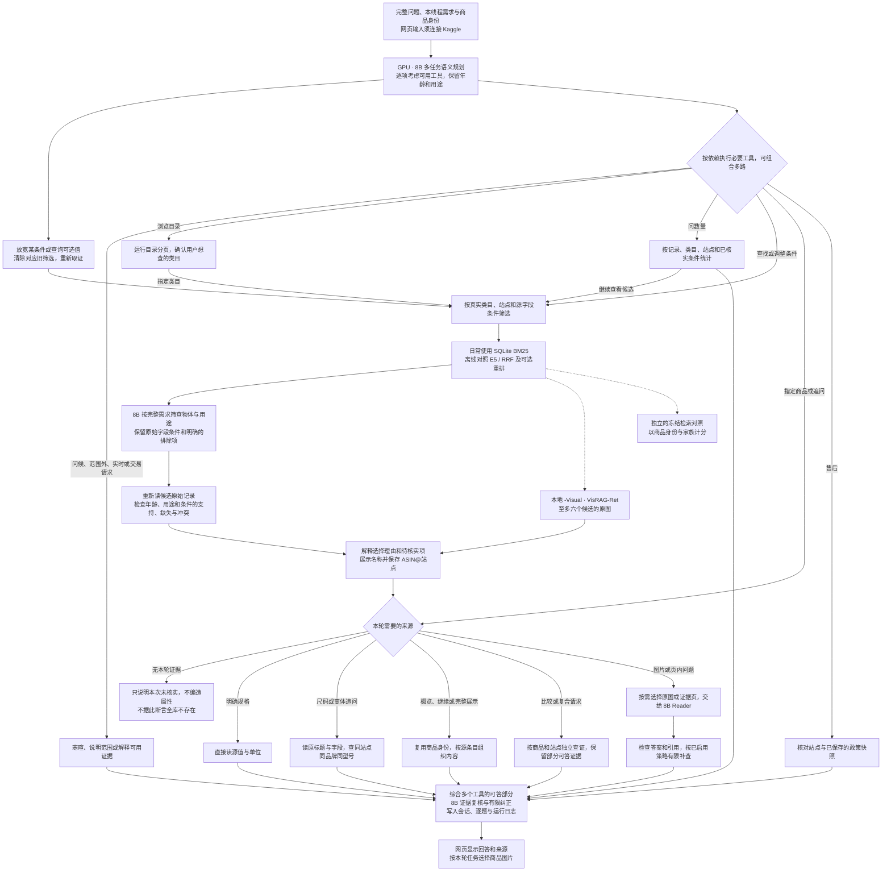
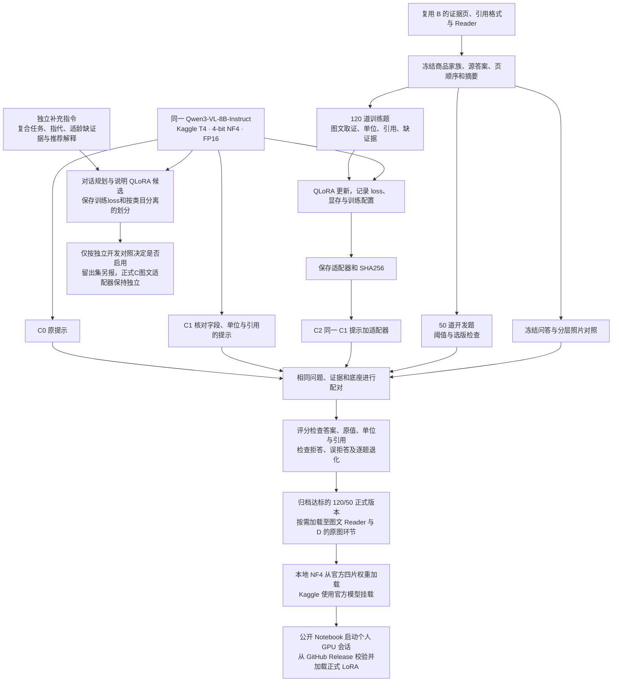
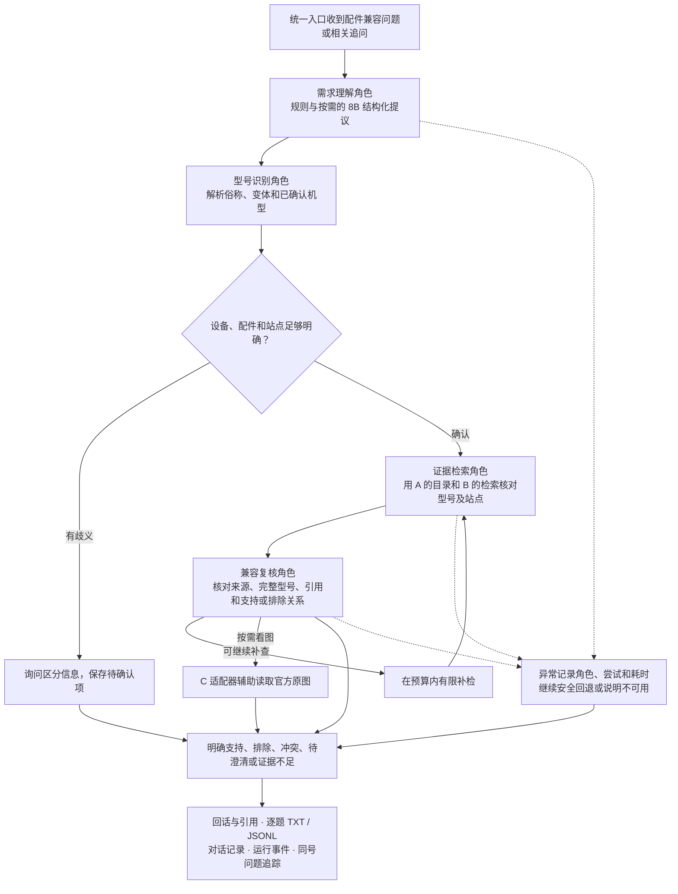

# A–D 阶段详细流程

四个阶段共享 ABO 商品身份、证据来源和逐题记录。A 建立商品数据和证据，B 用这些资产完成会话取证，C 在固定证据上训练和验证图文适配器，D 复用目录、检索和按需读图来核对配件兼容。网页、FastAPI、PowerShell 和 Kaggle 使用同一个 Adaptive-rag 会话入口。

[首页总流程图](../README.md#a-d-总流程) · [统一问答与分流](ABO架构与验证.md) · [日志与排查](日志与排查.md)

## A 阶段

### 商品数据、索引与证据

全量覆盖指商品元数据与索引。原图和派生证据页按用例或请求准备。新 Notebook 验证了覆盖 576 类的 1,089 次来源字段和引用抽查。全库结构检查与字段答题使用各自的报告。

- [构建全库与站点身份](../abo_runtime/upstream/VisRAG/personal/ecommerce_rag/full_catalog.py) · [生成向量](../abo_runtime/upstream/VisRAG/personal/ecommerce_rag/full_dense.py)
- [生成图文证据卡](../abo_runtime/upstream/VisRAG/personal/ecommerce_rag/full_cards.py) · [全库核对](../abo_runtime/upstream/VisRAG/personal/ecommerce_rag/a_catalog_verify.py) · [全类目抽查](../abo_runtime/upstream/VisRAG/personal/ecommerce_rag/a_category_audit.py)

## B 阶段

### 对话、检索与按需取证

目录页码、上一轮筛选条件和当前选中的商品分别维护。目录数量以历史商品记录为单位，同一 ASIN 在不同站点可分别出现。明确的颜色、材质、尺码和款式条件在排序前核对，查询现有库存时只报告可验证的历史字段。尺码保留 US、UK、EU 等原始标注，同站点的变体需核对品牌与型号。Notebook 与本地日常会话使用 BM25。本地 `-Visual` 可对文字检索候选做商品图重排。B 的冻结检索对照另有独立协议。

CPU 模式沿用明确请求的确定性取证。GPU 模式在其上增加每轮多任务计划、需求记忆、推荐说明和来源复核。同一问题可同时统计、搜索、比较、说明缺失价格与展示照片。[历史续聊和断线恢复](多任务对话与恢复.md)保存各线程独立状态，不再由新对话自动发送“重置”。

- [新项目会话路由](../app/abo/service.py) · [商品对话与逐件答证](../abo_runtime/upstream/VisRAG/personal/ecommerce_rag/full_app.py)
- [检索模式](../abo_runtime/upstream/VisRAG/personal/ecommerce_rag/full_retrieval.py) · [原始字段、单位和图片证据](../abo_runtime/upstream/VisRAG/personal/ecommerce_rag/full_evidence.py) · [售后快照](../abo_runtime/upstream/VisRAG/personal/ecommerce_rag/full_policy.py)
- [冻结检索对照](../abo_runtime/upstream/VisRAG/personal/ecommerce_rag/b_retrieval_scope.py) · [可读展示](../app/abo/presentation.py)

## C 阶段

### 8B 图文微调与同题对照

训练和选版记录沿用原冻结协议。C0、C1、C2 比较回答侧的变化，B 的检索质量使用 B 的独立协议。日常会话复用已确认好的适配器摘要。日志维护发布无需重新微调。

- [协议和家族隔离](../abo_runtime/upstream/VisRAG/personal/ecommerce_rag/c8_protocol.py) · [4-bit 加载](../abo_runtime/upstream/VisRAG/personal/ecommerce_rag/qwen8_runtime.py) · [QLoRA 与对照运行](../abo_runtime/upstream/VisRAG/personal/ecommerce_rag/c8_experiment.py)
- [训练集扩展与适配器选版](../abo_runtime/upstream/VisRAG/personal/ecommerce_rag/c8_upgrade.py) · [照片覆盖评测](../abo_runtime/upstream/VisRAG/personal/ecommerce_rag/c8_visual_breadth.py) · [加载并核验正式适配器](../abo_runtime/upstream/VisRAG/personal/ecommerce_rag/c8_reader.py)

## D 阶段

### 配件兼容、多角色核验与故障记录

兼容结论依赖可核实的型号和站点证据。遇到故障时，逐题记录继续保留角色、次数、回退和原始来源。独立的 D 评测代码支持冻结场景与故障注入。日常 Kaggle 验收走过俗称澄清、候选搜索、指代追问和 LoRA 辅助读图。

- [需求和用户原文校验](../abo_runtime/upstream/VisRAG/personal/ecommerce_rag/d_compat_route.py) · [型号与来源匹配](../abo_runtime/upstream/VisRAG/personal/ecommerce_rag/d_compat_catalog.py)
- [四角色和故障恢复](../abo_runtime/upstream/VisRAG/personal/ecommerce_rag/stage_d.py) · [统一交互](../abo_runtime/upstream/VisRAG/personal/ecommerce_rag/d_chat.py) · [冻结验收与故障注入](../abo_runtime/upstream/VisRAG/personal/ecommerce_rag/stage_d_eval.py)
