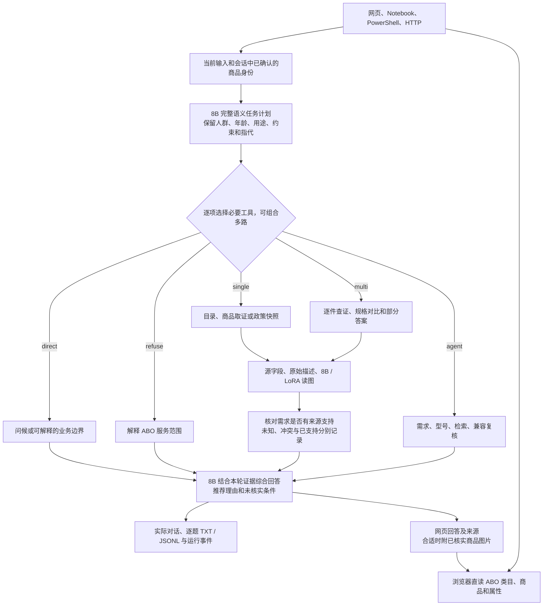

# ABO 架构与验证

应用以 Adaptive-rag 的 FastAPI、LangGraph 状态与工具策略实现 ABO 配置。GPU 模式由 Qwen3-VL-8B-Instruct 对每轮完整输入生成多个必要任务，按依赖执行工具并综合新证据。CPU 模式保留明确字段、目录和兼容取证能力。两种模式使用同一份商品身份和来源。

[A–D 阶段详细流程](A-D阶段流程.md) · [日志与排查](日志与排查.md)

商品的身份由 ASIN 和站点共同确定。目录翻页与商品展示各自依赖最近任务。明确要求全部资料时一次给出该商品的可读源属性、产品要点、原始描述和来源字段。要求剩余资料时依据已经展示的源条目。价格、实时库存和交易动作都有明确的资料边界。

商品比较先分别核对证据。重量和尺寸仅在可验证单位内换算。缺失值或不可比单位保留可确认部分。同步给出规格与价格要求时，已验证规格仍会返回。

同一句话可以同时统计手表数量并检索风扇，或找适龄篮球、解释选择并展示照片。各工具结果和需求检查写进逐题记录。历史回答仅用于理解指代；本轮商品事实总是重新读源。线程快照、通道重连和请求去重见[多任务对话与恢复](多任务对话与恢复.md)。

原项目的全量 ABO 索引、冻结协议、C 阶段 120/50 LoRA 和 D 阶段四角色可读证据工作流来自 VisRAG 派生项目。常用数值来自本项目的实际运行和冻结题集。

- [Adaptive-rag 源码](https://github.com/JEen-wang/Adaptive-rag/tree/2a12a62382a8c3ec033fa9a5b19b9b23b8780ab8)
- [Adaptive-rag 路由设计](https://github.com/JEen-wang/Adaptive-rag/blob/main/docs/04-adaptive-rag.md)
- [ABO 数据与许可](https://amazon-berkeley-objects.s3.us-east-1.amazonaws.com/index.html)
- [Qwen3-VL-8B-Instruct](https://huggingface.co/Qwen/Qwen3-VL-8B-Instruct)
