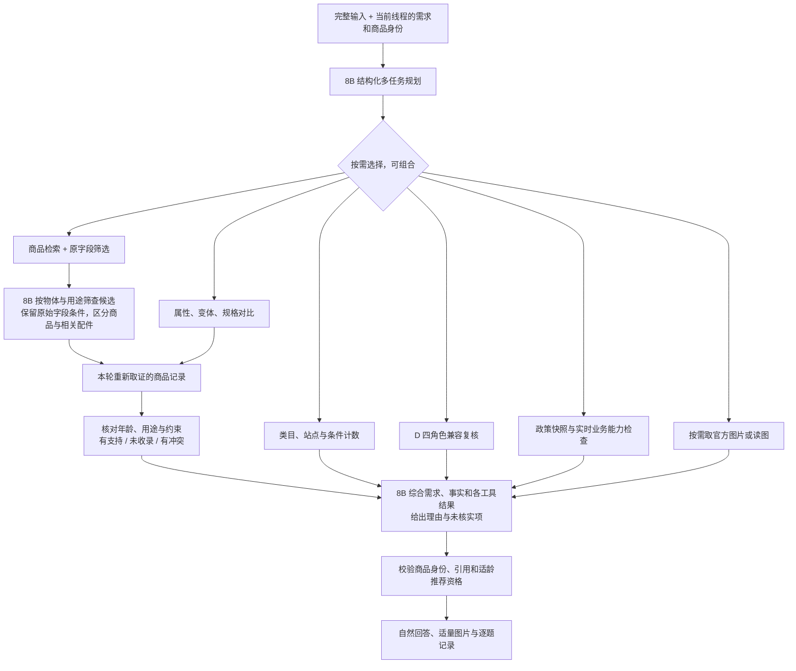
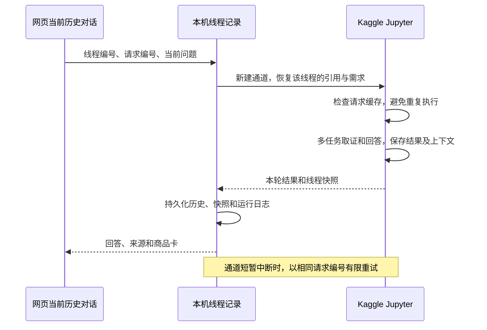

# 多任务对话与恢复

GPU 模式每轮先由 Qwen3-VL-8B 识别完整需求，再选出需要的工具。任务之间可以共享已确认的商品身份和当前用户条件。工具仍按各自的来源与能力回答，最后综合成自然中文。

例如给 8 岁男孩选篮球，会把年龄与用途存入本段需求，再从候选来源核对明确的年龄范围。仅有“7号球”不能证明适合8岁，资料没有年龄也不能解释成没有年龄限制。追问第一款的理由会重新读取第一款资料，说明可核实的特征与仍缺少的适用性依据。性别不用于推导颜色偏好或运动能力。

一句话同时涉及价格和规格时，价格来源缺失只影响价格部分；有来源的规格与选择理由继续回答。选购助手不能保证理解任意措辞，歧义、缺证据和模型失败会分别记录，并保留可确认的内容。

新对话不发送隐藏的“重置”。历史记录保持可续聊，浏览器和本机服务重启后从项目目录恢复。不同历史对话的选中商品、候选和需求分别保存，Kaggle 共用一个已加载的 8B。Kaggle GPU 会话真正结束或地址过期时，需要用户取得新的有效地址；本机已保存的线程仍可在重连后恢复。

浏览器历史迁移时，旧文字仅作为指代理解的上下文，商品卡编号会回到当前 ABO 记录重新查证。聊天历史不会成为商品事实来源。历史只在自己的项目目录保存，不随 GitHub 同步。

对话规划与取证说明的补充 QLoRA 实验入口为 `python -m app.abo.dialogue_training --output <新的运行目录> --all-text-layers`。其指令集、按类目分开的划分、训练 loss、开发对照、候选权重摘要和选择结果都独立保存，正式 C 图文适配器沿用原冻结协议。新增指令实验的覆盖范围单独报告，不能用它声称已经验证全部 576 类或所有日常表达。

2026-11-18 补充训练使用221条训练指令、28条开发与28条留出指令。开发题检查复合工具、年龄性别、候选序号、颜色排除、预算和用途保留，以及缺少年龄证据时的说明契约。基座9/28，选定候选26/28，留出26/28；这些是模板化指令契约结果，不能当作真实问答准确率或全类目验证。未达标的首个候选（7/20降至5/20）已保留。评分器曾把所有条件按黑色检查，修正后对全部基座与候选原始输出统一重算，旧评分文件保留，权重和题目没有修改。

检索条件优先核对原始属性。某些ABO记录的原始颜色与标准化颜色冲突，标准化值不能覆盖明确的原值。数值保留单位、原始值与归一化值；多语种资料数字不同时单独提示核对。推荐和复核也检查承重与重量、内外尺寸、标签与绝对承诺等区别。

[规划和综合](../app/abo/turns.py) · [线程状态](../app/abo/state.py) · [云端去重](../app/abo/cloud.py) · [训练实验](../app/abo/dialogue_training.py)

训练实现参考 [PEFT 量化训练说明](https://huggingface.co/docs/peft/developer_guides/quantization) 与 [Qwen3-VL 模型接口](https://huggingface.co/docs/transformers/model_doc/qwen3_vl)。
